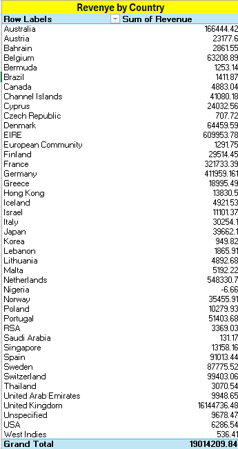
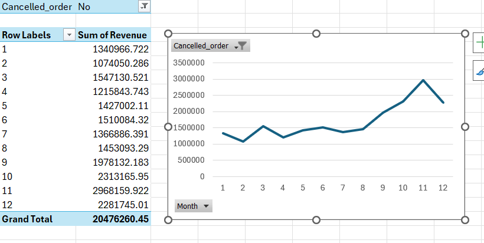
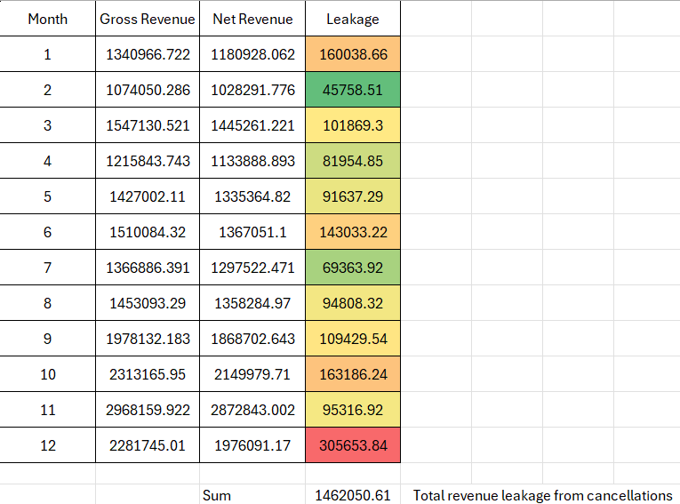

# Retail Revenue Leakage & Retention Analysis

End-to-end analysis of about 1 million UK online retail transactions (Dec 2009 to Dec 2011) to find where revenue is lost and which customers are leaving.

**Tools:** Excel, Power Query, SQL Server, Power BI

---

## Problem
A UK online gift shop loses money in two quiet ways: orders get cancelled, and customers stop coming back. Where does the shop lose money, and which valuable customers should it try to win back first?

## Dataset
Online Retail II, UCI Machine Learning Repository: https://archive.ics.uci.edu/dataset/502/online+retail+ii

About 1 million sales lines, 1 December 2009 to 9 December 2011. All money values are in British pounds (£).

## What I did

**1. Excel and Power Query**
- Cleaned the raw data: removed duplicates, removed rows with zero or negative price, trimmed text.
- Flagged cancelled orders instead of deleting them, because they are the money I am measuring.
- Kept orders with no customer ID separate (guest orders), because they are real sales.
- Validated the results with pivot tables by country and by month, and built a Gross vs Net comparison to measure leakage.

**2. SQL Server**
- Loaded the raw file into a staging table, then built a cleaned table.
- Built a star schema: one fact table (1,061,146 rows) and three dimension tables (customer, product, date). Fact rows match the cleaned table exactly, so no data was lost.
- Wrote queries for RFM customer segmentation, cohort retention, monthly revenue leakage, and running totals with month-on-month growth, using CTEs and window functions (NTILE, LAG, FIRST_VALUE).
- Saved the results as views for Power BI.

**3. Power BI**
- Built a 4-page dashboard on top of the SQL views: Executive Summary, Customer Segments, Cohort Retention and Risk Watchlist.
- Created a date table, relationships and DAX measures (CALCULATE, DIVIDE, DISTINCTCOUNT, DATEADD and more).

## Key findings
- Net revenue was £19.45M, and £1.53M (7.28% of gross sales) was lost to cancellations.
- November is the peak month in both years. December 2011 is a partial month, because the data ends on 9 December.
- Only about 21% of new customers buy again in the first month, and about 18% are still buying at month 12.
- 1,274 Champions (22% of customers) bring about 72% of the spend of identified customers.
- 3,228 customers (55%) are At Risk or Lost, but they hold only about 10% of spend (£1.76M). 200 of them are high-value win-back targets.

## Recommendations
- Start win-back offers with the 200 high-value lapsed customers, not all 3,228.
- Send a follow-up offer in the first month after a first purchase, because that is when most customers disappear.
- Find which months and products have the most cancellations, and investigate why.
- Plan stock and staffing before the November peak.

## Dashboard

### Executive Summary

### Customer Segments (RFM)

### Cohort Retention

### Risk Watchlist

## Excel validation

## Files in this repository

| File | What it is |
|---|---|
| `retail_analytics_full.sql` | All SQL queries: staging, cleaning, star schema, RFM, cohort, leakage, views |
| `RetailAnalytics_dashbaord.pbix` | The Power BI dashboard file |
| `Online_retail_csv_file.csv` | Data file used in the project (the full source dataset is linked above) |
| Dashboard and pivot screenshots (.png) | Pictures of each dashboard page and Excel check |

## How to explore
1. Read the SQL file from top to bottom. The queries are in the order they were run.
2. Open the .pbix file in Power BI Desktop to see the pages, measures and model. The data came from my local SQL Server, so refreshing will not work on another computer, but everything else can be explored.

## Notes and limits
- Guest orders (no customer ID) are included in revenue totals but excluded from customer-level analysis, so they appear as Blank in the country chart.
- Segment cut-offs (Champion, Loyal, At Risk, Lost) are my own assumptions.
- "Revenue at risk" means the past spend of lapsed customers. It is not a forecast.
- The data does not say why orders were cancelled. The dataset is public data from 2009 to 2011, so this project shows a method, not today's reality.

## Skills shown
SQL (joins, CTEs, window functions, views, star schema) | Power BI (data modelling, DAX, dashboard design) | Excel (Power Query, pivot tables) | Data cleaning and validation | Customer segmentation (RFM) | Cohort analysis | Business recommendations

## Status
- [x] Excel
- [x] SQL Server
- [x] Power BI
- [ ] Python extension (planned: exploratory analysis and a churn model, after I learn Python)
